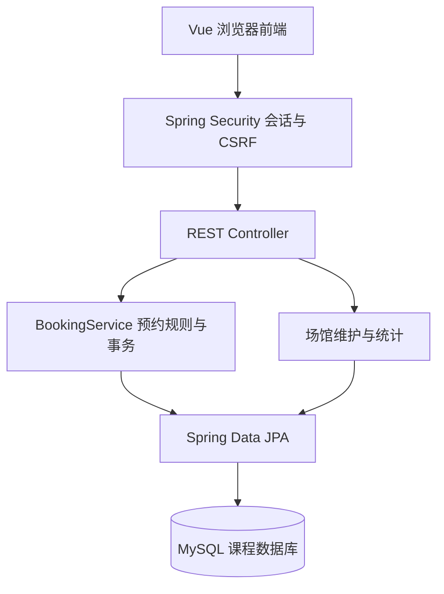
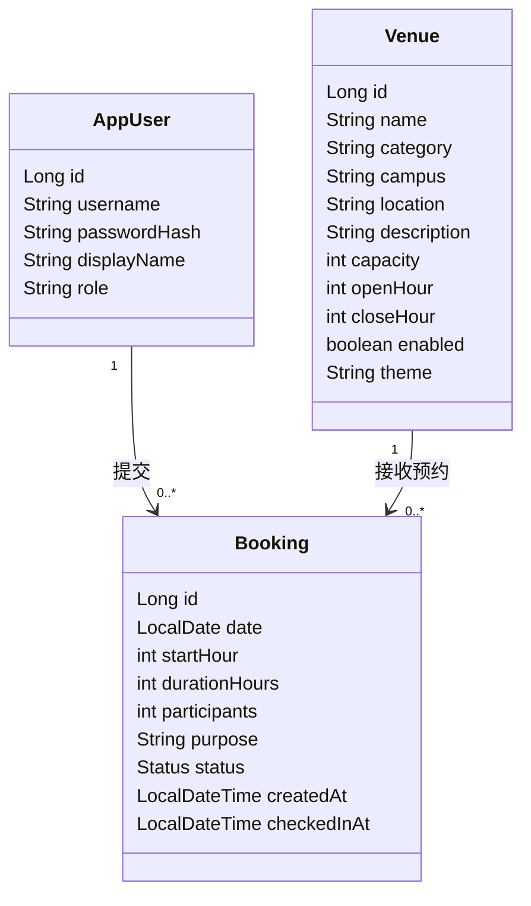
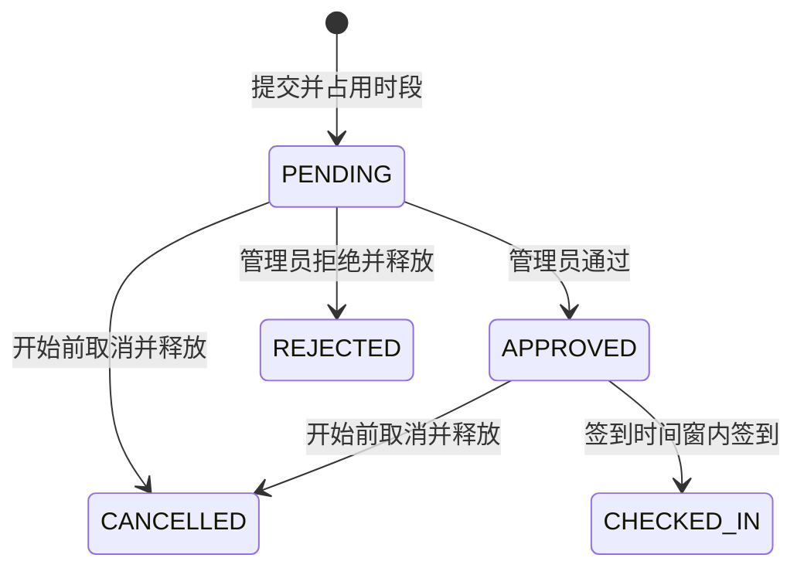

# 系统设计

山东大学场馆预约管理系统面向各校区运动空间的预约与日常运营。基础版本覆盖学生预约和管理员审核两种角色，前端不直接连接数据库。生产环境使用 Spring Boot 同时提供静态前端和业务 API。

## 功能结构

## 实体 UML

## 预约状态

## 数据一致性

每次创建预约或改变预约状态，事务先锁定对应场馆记录，再读取和修改预约。创建预约检查同场馆、同日期是否存在与完整预约区间重叠的待审核、已通过或已签到记录。采用 READ_COMMITTED 隔离级别，保证等候行锁后读取到已提交的占用情况。多块独立场地须拆分为独立场馆记录。

数据库没有用“场馆 + 日期 + 小时”的简单唯一键，因为取消和拒绝的历史记录需要保留，且不应阻止后续预约。所有占用相关写入口都必须保留同一行锁策略。后续扩展批量导入或管理操作时也应遵循该策略。

## 当前范围

本阶段已实现主要业务流程。2026-10-31 已连接学校第 11 组 MySQL 库，执行三张表的建表脚本，通过 Hibernate 结构校验，并验证登录、预约、审核、取消及释放时段。学校库只初始化账号和场馆，没有导入 H2 中的历史演示记录。现有并发自动化测试使用 H2，尚未在学校 MySQL 上进行并发压力测试。尚未上传或部署到课程应用服务器。

建议后续按实际团队人数分工：学生预约页面与交互、管理员场馆和审核、后端业务与数据库、测试部署与报告。具体负责人和工作量由团队确认，不能直接作为已完成贡献提交。

每次预约可选连续 1 或 2 小时，用途从页面下拉菜单选择。签到仅允许预约学生本人操作，管理员无法代签。学校库的历史预约保留并通过迁移设置为 1 小时。

2026-11-01 本地新增校区字段与多校区目录，预览切换到 H2。学校库尚未执行 002 校区迁移，新版 MySQL 启动前需按 README 升级。
